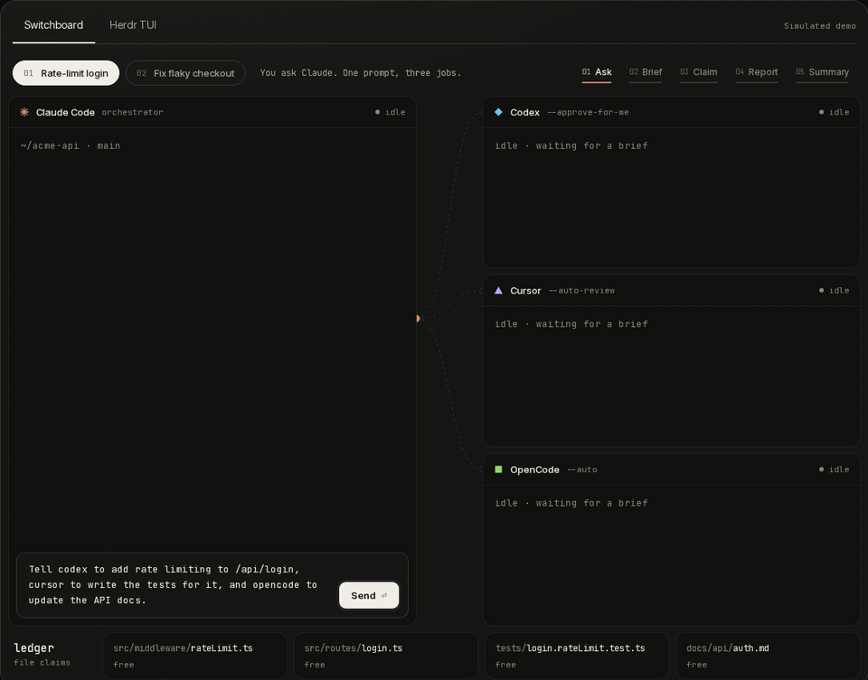

# Agent Cowork Memory (ACM)

```
 █████╗  ██████╗███╗   ███╗
██╔══██╗██╔════╝████╗ ████║
███████║██║     ██╔████╔██║
██╔══██║██║     ██║╚██╔╝██║
██║  ██║╚██████╗██║ ╚═╝ ██║
╚═╝  ╚═╝ ╚═════╝╚═╝     ╚═╝
```

Hit your Codex limit mid-task? Open Cursor, say **"continue from Codex"**, and keep going. ACM gives Codex, Claude Code, Cursor, and OpenCode one shared memory, so you never paste context again, and any agent can put the others to work.


 Codex  ·   Claude Code  ·   Cursor  ·   OpenCode

## Demo



More demos on the [ACM official site](https://acm-website-sand.vercel.app/)

## Install

With [Node 24](https://nodejs.org) or newer:

```sh
npx agent-cowork-memory setup
```

Setup adds ACM to Cursor, and to Codex, Claude Code, and OpenCode when they are installed; Installed one later? Run setup again. Restart your agents, and ACM is available in every project.

Tested for real on Linux and WSL. macOS and Windows pass CI; real runs welcome.

## Use

### Memory Sharing

Open the same project in Codex and Cursor. To pick up a chat in the other agent, ask:

> Use ACM to continue from Cursor.

Or, in Cursor:

> Use ACM to continue from Codex.

Every agent can see every chat in the project. If there is more than one, the agent lists them (agent, time, thread, first message, and whether ACM started it for a delegated job) and asks you which one to continue. You can also name it:

> Use ACM to continue the Codex chat about the trip.

Related work goes together in a **thread**: continuing a chat, or delegating from it, keeps the work on one thread, and a new chat can join one of the project's open threads. ACM keeps each thread's timeline as things happen (chats joining, jobs starting and finishing, notes added), so any agent can see where the work stands.

Ask your agent to remember a decision, and every agent in the project sees it. Notes stay true.

### Delegate to other agents

Any agent can hand work to the others:

> Tell codex to write plan.md, and claude to write packing.md.

Each agent gets a brief, joins the thread it was sent from, claims the files it edits so they don't collide, and reports back. Agents run in the background. With [herdr](https://herdr.dev) installed, each one gets its own pane you can watch (`herdr session attach acm`).

## Benchmark

Does a new chat pick up what earlier chats left, without losing any of it? Each task is a small Python repo in two steps: earlier chats do step 1 and leave step 2's details in the chat, and a new chat is asked to *"continue from my last Codex chat in this repo and finish the task, including step 2"*; without ACM, to *"see what I told Codex to do in this repo, and finish the task, including step 2."* Runs are scored strictly: a run finishes only if every hidden check passes, the repo's existing tests still pass, no file is deleted, text you said to leave as it is is untouched, and no old or replaced value was implemented. The checks themselves were tested: each task has 3 to 5 plausible wrong solutions (the old rule, a natural guess, a near miss), and every one is caught, while a second, independently written solution passes.

### Held-out tasks, design frozen first

48 new tasks, written before any run, with the design and the analysis frozen first. Each task's earlier chats ran twice, independently, and every way ran 3 times on each. After the plan's guards and admission rule, which never look at ACM, 38 tasks were analysed. Codex with gpt-6-luna at medium effort:

| | No ACM | ACM | Summary pasted | Handoff note pasted | Full chat history pasted |
|---|---|---|---|---|---|
| Finished, strictly | 0/76 runs | **223/228** | 130/228 | 214/228 | 222/228 |
| Finished strictly in all 6 runs | 0/38 tasks | **34/38** | 8/38 | 29/38 | 32/38 |
| Implemented an old or replaced value | 13/76 | **0/228** | 7/228 | 0/228 | 0/228 |
| What you type or paste, median | 80 characters | **95** | 753 | 2,740 | 1,940 |
| Input tokens per handoff, median | 109k | 242k | 248k | 312k | 100k |

- **ACM loses less context than a pasted summary: confirmed.** ACM finished strictly more often on 29 of the 38 tasks and less often on none: 41 points more (95% interval 31 to 50; p < 0.001, Holm-adjusted), in each history on its own. The plan required at least 15.
- ACM did as well as pasting every earlier chat: 0 points apart (one-sided 95% bound −1; the plan's margin was −5).
- A careful handoff note did nearly as well, once it was pasted in full. Asked for *"a handoff note so a new chat can continue this work"*, the earlier chat often wrote it to `HANDOFF.md` and answered with a pointer. The planned run pasted that answer alone, so its result (ACM 51 points ahead) measures a lost note, not a note. Pasting the file too, as in the table (exploratory, run after the fact): 4 points behind ACM (95% interval 1 to 7), from asking for the note and pasting about 2,700 characters.
- Tokens: ACM's handoff costs about what a summary does once you count writing it (242k against 248k input tokens); pasting the full history is cheapest (100k).

### Development tasks

The held-out run's design came from this run, on the 60 tasks the harness, the ask, and ACM's `resume` were tuned on. Step 2's details sit in one short or long chat, spread over two chats, changed in a later chat, corrected mid-chat, against a README or docstring that still says the old thing, or in a repo that hides them behind config, where the agent can find them. The new chat continued four ways: with no ACM, with ACM (*"Use ACM to continue…"*), with the summary the earlier chat wrote when asked *"Summarize this chat so I can continue in a new chat"*, or with every earlier chat pasted in. Each way ran 3 times per task, every chat on gpt-6-luna at medium effort.

| | No ACM | ACM | Summary pasted | Full chat history pasted |
|---|---|---|---|---|
| Finished, strictly | 17/180 runs | **176/180** | 124/180 | 166/180 |
| Finished strictly in all 3 runs | 3/60 tasks | **57/60** | 28/60 | 48/60 |
| Details from the earlier chats done right | 37/486 | **483/486** | 374/486 | 456/486 |
| Implemented an old or replaced value | 99/180 | **2/180** | 16/180 | 2/180 |
| What you type or paste, median | 80 characters | **95** | 733 | 1,736 |
| Chats you find and copy | 0 | **0** | 1 | 1-2 |
| Input tokens per handoff, median | 103k | 216k | 213k (88k, plus 112k to write the summary) | 89k |

| Finished strictly, by earlier chats | No ACM | ACM | Summary pasted | Full chat history pasted |
|---|---|---|---|---|
| One short chat (16 tasks) | 0/48 | 46/48 | 28/48 | 44/48 |
| One long chat (6) | 0/18 | 18/18 | 9/18 | 17/18 |
| Spread over two chats (6) | 0/18 | 18/18 | 11/18 | 17/18 |
| Changed in a later chat (6) | 3/18 | 18/18 | 16/18 | 16/18 |
| Corrected mid-chat (6) | 0/18 | 18/18 | 15/18 | 16/18 |
| The repo still says the old thing (12) | 0/36 | 36/36 | 23/36 | 35/36 |
| The repo hides the facts behind config (8) | 14/24 | 22/24 | 22/24 | 21/24 |

Tested per task, exact sign-flip test, as planned:

- **ACM loses less context than a pasted summary.** Strictly, across the 50 tasks whose details live in chats, ACM finished more runs on 30, fewer on 1, and the same on 19: 33 points more on average (95% interval 24 to 43; p < 0.001). The test planned before the run, on details done right in 43 admitted tasks, gave 23 points (15 to 32). The summaries left out 19% of the planted details, 49% after a long chat, and led 16 runs to implement an old value; ACM's handoff left none out.
- ACM beat no ACM on 55 of 58 tasks (p < 0.001), and strictly finished 6 points ahead of the full chat history pasted (95% interval 1 to 11; an exploratory comparison), from one sentence instead of finding and pasting each chat.
- Where the repo itself can show the facts again, ACM saved no exploring: it took 1.2 more explore steps than the summary (p = 0.23). The agent reads about as much whatever it's handed.
- Tokens: ACM reads 2.6x the input tokens of a chat handed the summary, but writing the summary costs about as much, so per handoff the two are even (216k against 213k; 20k against 23k uncached). Pasting the full history is cheapest.

What it doesn't show:

- The development tasks are the ones the harness, the ask, and ACM's `resume` were tuned on. The held-out run tests the claim on tasks none of that touched. Its handoff-note comparison is exploratory, run after the fact (after the run).
- The tasks are built so step 2's details live in earlier chats. That shows what ACM does when that happens, not how often your work looks like it.
- One summary prompt and one note prompt. A user who fixes the summary by hand may lose less; a careful note, pasted in full, came close to ACM.
- Of the 48 held-out tasks, 2 lost their earlier chats to the guards in the pilot (a planted value written into the repo, or step 1 not done as asked), 6 failed admission, and 2 more lost their earlier chats in one history, all before any ACM run counted. In the development set, 2 tasks whose earlier chats wrote the rules into the repo are left out of the strict tests, and about 20 edge cases no check tests are listed in its plan; they are lenient for every way alike.
- Codex continued Codex chats, all on gpt-6-luna at medium effort (Codex CLI 0.162.1, October 2026). Luna kept to an old "Don't start step 2" unless the new ask said "including step 2", so every way's ask does. ACM reads Claude Code and OpenCode chats the same way, checked offline below, but they weren't run live. When ACM asked which chat, a scripted user answered "The newest one."
- ACM as it is in this repo, ahead of the 0.3.0 release: `resume` now also brings the user's earlier messages and what they said in the thread's other chats. Without the second, Luna lost 6 details in two-chat tasks by never opening the earlier chat.

Offline checks (free, deterministic, run in CI):

| Check | Result |
|---|---|
| Resume of a 10-message chat, in all 4 agents' chat formats | opening, middle, and latest request all carried |
| Resume of a 160-message chat | opening and latest request carried; one midway lost (resume keeps the last 30 messages up to 12,000 characters, and the user's earlier messages up to 6,000) |
| Note found in the top 3 by keyword search | 21/40 |
| Note found in the top 3 by a question ("how do we …?") | 0/40 |
| Contradicted note pointed out by `note_add` | 30/40 |
| Note marked stale when its file changes | yes when the note gives the path; no when it names only the file (`pool.ts`) |
| ACM's tool descriptions, in every chat | ≈1,200 tokens |
| First `context` with 40 long notes | ≈2,900 tokens |

```sh
npm run bench        # offline checks
npm run bench:live -- --model gpt-6-luna --effort medium   # the development benchmark; spends your Codex quota (about 1,000 chats)
```

The development runs are in `bench/results/live.json`: `node bench/live.ts --report bench/results/live.json` prints their tables, and `--rescore` rebuilds each run's repo from its logs and scores it strictly again. The held-out runs are in `bench/results/confirm/`; `--confirm` prints their analysis.

## MCP tools

| Tool              | What it does                                                                                                                                                                                                                                                                                               |
| ----------------- | ---------------------------------------------------------------------------------------------------------------------------------------------------------------------------------------------------------------------------------------------------------------------------------------------------------- |
| `context`       | Your thread and its timeline, the project's notes (after the first call, only what's new), open threads, recent jobs, who is working, and held files. Pass `hold` to claim files before writing, `thread` to join one, `done` to close yours. `stale` lists notes whose files changed, to re-check. |
| `note_add`      | Saves a note every agent sees, and shows notes it may contradict. `tier`: `short` (default, kept 7 days) or `long`; `supersedes`: the note it replaces.                                                                                                                                             |
| `note_search`   | Finds notes and delegated jobs' results.                                                                                                                                                                                                                                                                   |
| `chats`         | Lists recent chats from every agent in the project, and marks the ones ACM started.                                                                                                                                                                                                                        |
| `resume`        | Asks you which chat to continue when there are several, then reads it, with what you said in its thread's other chats, and joins its thread.                                                                                                                                                               |
| `delegate`      | Starts other agents with a brief, in herdr panes or in the background, and waits for them.                                                                                                                                                                                                                 |
| `delegate_wait` | Keeps waiting on this chat's delegated agents.                                                                                                                                                                                                                                                             |

ACM tells which chat it is in on its own; no tool needs a session or, from the project folder, a path (every tool takes an optional `repo_path`).

## CLI

| Command                                                         | What it does                                                                 |
| --------------------------------------------------------------- | ---------------------------------------------------------------------------- |
| `acm setup`                                                   | Adds ACM to your agents.                                                     |
| `acm mcp --harness <agent>`                                   | Runs the MCP server; agents start it themselves.                             |
| `acm status [--repo <dir>] [--chat <id>] [--harness <agent>]` | The project's jobs, held files, and a chat's thread, as JSON.                |
| `acm doctor`                                                  | Checks the install: Node, the database, herdr, and which agents are on PATH. |
| `acm backup [--to <file>]`                                    | Copies the database.                                                         |

`--home <dir>` (or `ACM_HOME`) moves ACM's state folder from `~/.agent-cowork-memory`. Run them with `npx -y agent-cowork-memory <command>`, or `acm` once it's installed globally.
